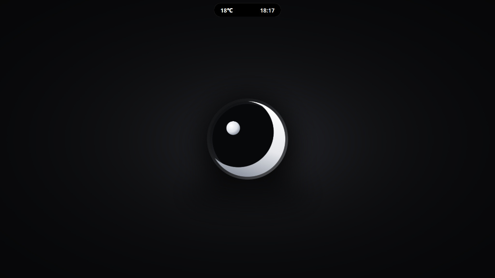

# Paithosh (Paithon's shell)

Simply a shell I built to tinker with.



## Installation

Run the installer with a single command:

```bash
curl -fsSL https://raw.githubusercontent.com/paithon5959/paithosh/master/install.sh | bash
```

## Why This Shell Exists

- This is a silly project made purely to mess around with new concepts. It is entirely vibecoded, quite absurd, and primarily intended for personal use.
- I already have a stable KDE setup that requires virtually zero maintenance and serves my daily workflow reliably.
- For Linux larpers, this might look like an ego-driven showcase. In reality, it is merely poking fun at the current state of the ricing community. My personal computing priorities shifted long ago; I am a Fedora user.

## Contributing & Issues

- **Pull Requests:** This is a personal DIY project. If a PR brings something I genuinely like and find useful, I'll merge it. Otherwise, it will be closed without comment.
- **Issues:** Maintained strictly by personal whim and intuition, not community demand. That said, legitimate bug reports are welcome and will be fixed.

## License

This project is licensed under the MIT License. See the [LICENSE](LICENSE) file for details.
